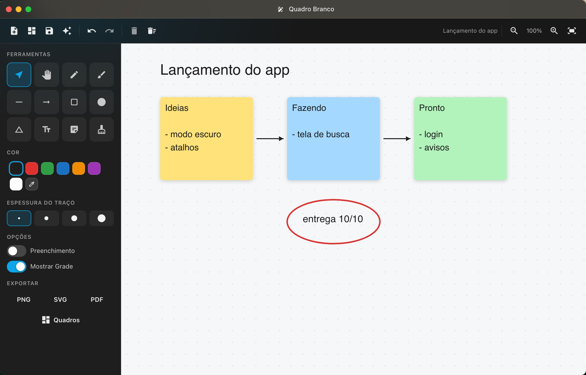
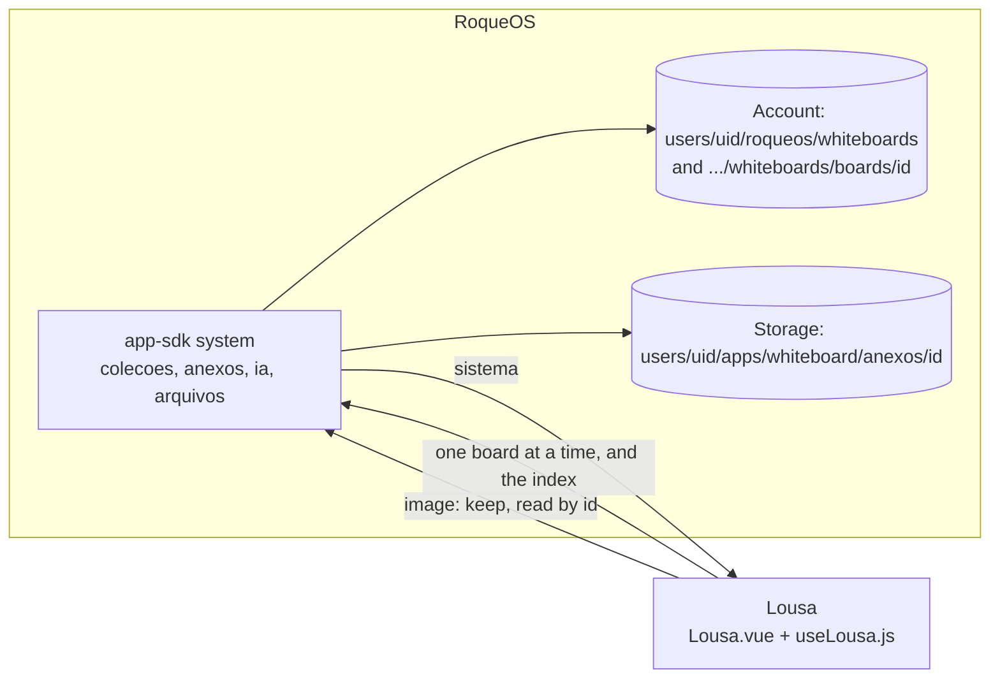

# Whiteboard (Lousa)

_[Português](README.pt-BR.md) | English_

The Whiteboard app of [RoqueOS](https://roqueos.com.br): an infinite board with rectangle, ellipse, diamond, line, arrow, freehand pencil and pen, text, sticky notes and images; select, move, resize and rotate; undo and redo; several boards in the account, with the last one opened coming back; export as PNG, SVG and PDF; save the board as `.rosboard` to Files and open a `.rosboard` back with a double click in Finder; and AI over what is written (summarize, group into themes, extract actions). In the ten RoqueOS languages. The repository is called `lousa`; on screen the app is the Whiteboard.

Free to use at [roqueos.com.br](https://roqueos.com.br), on desktop, phone and TV.



## Why it is its own repository

The Whiteboard was born inside RoqueOS, which is closed. On 28/09/2026 it moved to its own repository in the [roqueos-apps](https://github.com/roqueos-apps) organization, the first app that reads one large document at a time and keeps images as attachments. RoqueOS installs it by tag, as a git dependency, and it talks to RoqueOS only through the [`app-sdk`](https://github.com/roqueos-apps/app-sdk). The screen is built with the [`ui`](https://github.com/roqueos-apps/ui) kit. The same code runs inside RoqueOS, alone in the browser (`yarn dev`) and in the tests.

## How it talks to RoqueOS



Only through the SDK `sistema`, with each optional capability declared in [`app.json`](app.json): `colecoes` (one document per board, read one at a time because a board gets close to the 1 MB the database accepts, plus the `whiteboards` index), `anexos` (pasted images by id; the address never reaches the app), `ia` (the read-only system AI panel with two Whiteboard actions), `arquivos` (save as `.rosboard` to Documents) and `abertura` (the `.rosboard` Finder hands over). Guests keep the board in memory with images embedded. Each change waits 800 ms and writes the whole open board; above 900 KB long freehand strokes keep half of their points and the app says so, and if it still does not fit it says so and does not write. The details are in [docs/ARCHITECTURE.md](docs/ARCHITECTURE.md).

## Getting started

Node 22 or newer (`.nvmrc` says 24) and Yarn 1.22.

```bash
yarn install --ignore-scripts
yarn dev          # the Whiteboard in a fake RoqueOS window, on a local account
yarn verificar    # lint, format, tests and app check: the same as CI and pre-push
yarn test         # tests only
```

In the `yarn dev` window boards live in `localStorage` and survive F5; images live in memory and disappear on F5. Below 700 px wide the narrow layout takes over. `?idioma=ar-AR` opens in Arabic, `?leve=1` as a weak device sees it, `?convidado=1` without an account. The full path is in [docs/GETTING-STARTED.md](docs/GETTING-STARTED.md).

## What each part is

| Path                                                                                                                 | What it is                                                                                                                            |
| -------------------------------------------------------------------------------------------------------------------- | ------------------------------------------------------------------------------------------------------------------------------------- |
| [`app.json`](app.json)                                                                                               | the manifest: permanent id `whiteboard`, names in ten languages, icon, color, window, capabilities, collections, the `.rosboard` type |
| [`src/index.js`](src/index.js)                                                                                       | `definirApp`: a Vue app of its own inside the element RoqueOS gives                                                                   |
| [`src/Lousa.vue`](src/Lousa.vue), [`src/Ferramentas.vue`](src/Ferramentas.vue), [`src/Quadros.vue`](src/Quadros.vue) | the screen, the tools, the board list                                                                                                 |
| [`src/useLousa.js`](src/useLousa.js)                                                                                 | the engine: state, pointer machine, history, autosave, images                                                                         |
| [`src/quadros.js`](src/quadros.js)                                                                                   | boards in the account through the system collections                                                                                  |
| [`src/elements.js`](src/elements.js), [`src/geometry.js`](src/geometry.js), [`src/history.js`](src/history.js)       | elements, geometry, undo                                                                                                              |
| [`src/serialize.js`](src/serialize.js), [`src/export.js`](src/export.js), [`src/pdf.js`](src/pdf.js)                 | SVG, PNG and PDF (the PDF with no dependency)                                                                                         |
| [`i18n/`](i18n/en-US.json)                                                                                           | the texts, one file per language                                                                                                      |
| [`dev/main.js`](dev/main.js)                                                                                         | `yarn dev`                                                                                                                            |
| [`test/`](test/app.spec.js)                                                                                          | Vitest: the app through the SDK, the engine, the pure pieces                                                                          |
| [`paridade.json`](paridade.json)                                                                                     | parity with the app inside RoqueOS                                                                                                    |

## Parity with the app before

[`paridade.json`](paridade.json) is the inventory of what the Whiteboard did inside RoqueOS and what happened to each item when it left: `mantida` (kept), `mudou` (changed, with a note) or `perdida` (lost, only with a written decision). Each item cites the test in this repo that proves it, or the evidence. RoqueOS checks the file in the installed package before accepting a version. Changed a feature, or a test cited there? Update the inventory in the same commit.

## Status and limits

Version 0.1.3, the one RoqueOS pins. The parity audit of 28/09/2026 recorded no measurement with a real session or on a real iPhone; this repo holds no newer one. A board above 900 KB after decimation is not autosaved, the PDF is a single raster page, and there is no realtime collaboration. The full list is in [docs/ARCHITECTURE.md](docs/ARCHITECTURE.md#9-known-limits).

## Documentation

Start at [docs/INDEX.md](docs/INDEX.md). By role:

| Question                          | Document                                                         |
| --------------------------------- | ---------------------------------------------------------------- |
| From zero to running              | [GETTING-STARTED](docs/GETTING-STARTED.md)                       |
| How it is built                   | [ARCHITECTURE](docs/ARCHITECTURE.md)                             |
| Every command, constant and field | [REFERENCE](docs/REFERENCE.md)                                   |
| Shipping, updating, undoing       | [OPERATIONS](docs/OPERATIONS.md)                                 |
| Something failed                  | [WHEN-IT-BREAKS](docs/WHEN-IT-BREAKS.md)                         |
| A term                            | [GLOSSARY](docs/GLOSSARY.md)                                     |
| How it talks to RoqueOS           | [INTEGRATIONS](docs/INTEGRATIONS.md)                             |
| What the tests prove              | [TESTING](docs/TESTING.md)                                       |
| Security                          | [THREAT-MODEL](docs/THREAT-MODEL.md), [SECURITY.md](SECURITY.md) |
| What is not reopened              | [DECISIONS](docs/DECISIONS.md)                                   |
| Adding a tool or a text           | [EXTENDING](docs/EXTENDING.md)                                   |

## Contributing

Read [CONTRIBUTING.md](CONTRIBUTING.md). Every commit carries `Signed-off-by` (DCO), and CI checks it. Security issues go through [SECURITY.md](SECURITY.md), never a public issue.

## Credits and license

[MIT](LICENSE). Icons are [Material Icons](https://fonts.google.com/icons) (Apache-2.0), through the interface kit; see [ASSETS.md](ASSETS.md). The RoqueOS name and brand belong to LEVELHARD and are not covered by the license.
