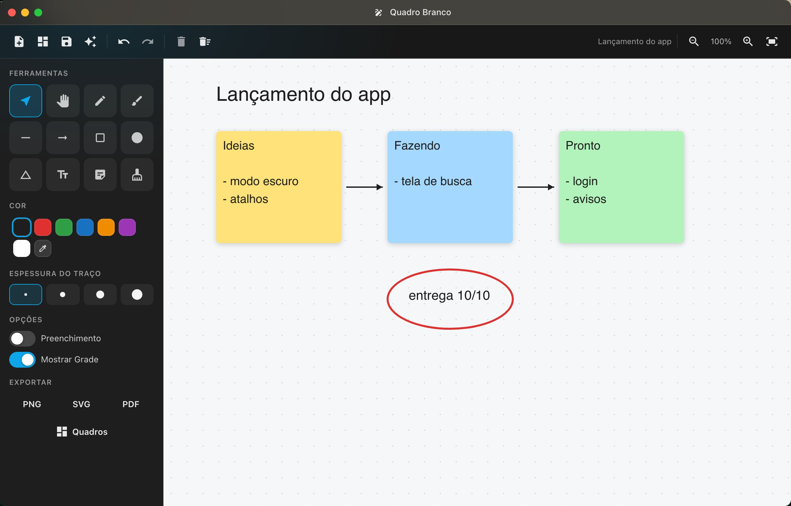
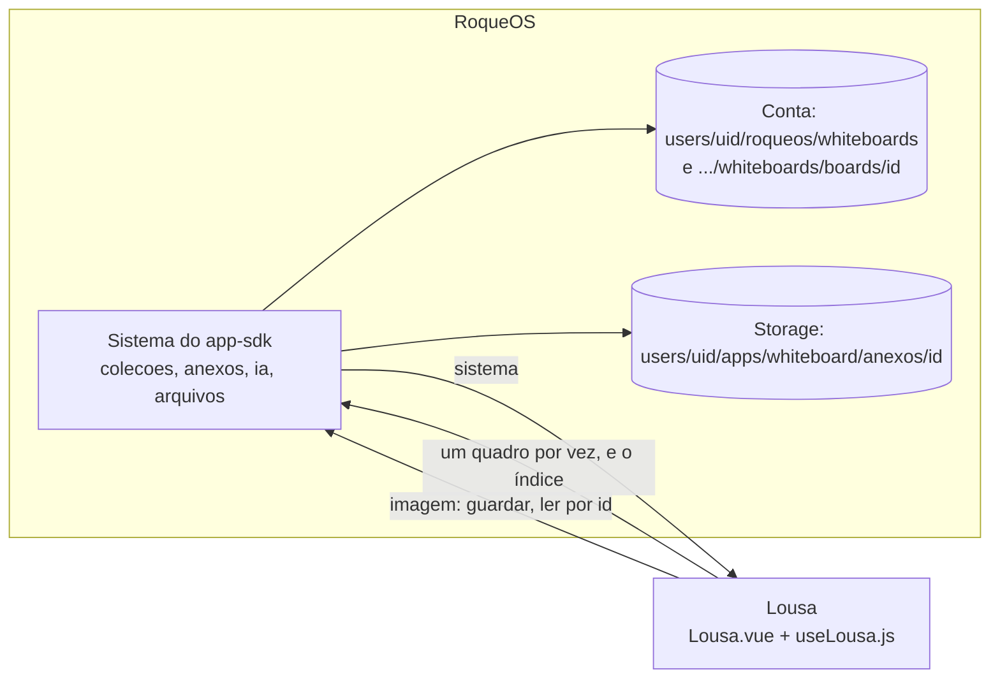

# Quadro Branco (Lousa)

_Português | [English](README.md)_

O Quadro Branco do [RoqueOS](https://roqueos.com.br): um quadro infinito com retângulo, elipse, losango, linha, seta, lápis e caneta à mão livre, texto, notas adesivas e imagens; selecionar, mover, redimensionar e girar; desfazer e refazer; vários quadros na conta, com o último aberto de volta; exportar em PNG, SVG e PDF; guardar o quadro como `.rosboard` nos Arquivos e abrir o `.rosboard` de volta com um duplo clique no Finder; e IA sobre o que está escrito (resumir, agrupar em temas, tirar as ações). Nos dez idiomas do RoqueOS. O repositório se chama `lousa`; na tela, o app é o Quadro Branco.

Use de graça em [roqueos.com.br](https://roqueos.com.br), no computador, no celular e na TV.



## Por que existe como repo

O Quadro Branco nasceu dentro do RoqueOS, que é fechado. Em 28/09/2026 ele foi para o próprio repositório na organização [roqueos-apps](https://github.com/roqueos-apps), o primeiro app que lê um documento grande de cada vez e guarda imagem como anexo. O RoqueOS o instala por uma tag, como dependência git, e ele fala com o RoqueOS só pelo [`app-sdk`](https://github.com/roqueos-apps/app-sdk). A tela é feita com o kit [`ui`](https://github.com/roqueos-apps/ui). O mesmo código roda dentro do RoqueOS, sozinho no navegador (`yarn dev`) e no teste.

## Como ele fala com o RoqueOS



Só pelo `sistema` do SDK, e cada capacidade opcional está declarada no [`app.json`](app.json): `colecoes` (um documento por quadro, lido um de cada vez porque um quadro chega perto do 1 MB que o banco aceita, mais o índice `whiteboards`), `anexos` (a imagem colada, por id; o endereço nunca chega ao app), `ia` (o painel de IA do sistema, só de leitura, com duas ações do Quadro Branco), `arquivos` (guardar como `.rosboard` em Documentos) e `abertura` (o `.rosboard` que o Finder entrega). Sem conta, o quadro vive na memória e a imagem entra embutida. Cada mudança espera 800 ms e grava o quadro aberto inteiro; acima de 900 KB os traços à mão livre longos ficam com metade dos pontos e o app avisa, e se nem assim couber ele avisa e não grava. Os detalhes estão em [docs/pt-BR/ARQUITETURA.md](docs/pt-BR/ARQUITETURA.md).

## Como começar

Node 22 ou mais novo (o `.nvmrc` diz 24) e Yarn 1.22.

```bash
yarn install --ignore-scripts
yarn dev          # a Lousa numa janela falsa do RoqueOS, numa conta local
yarn verificar    # lint, formato, testes e app check: o mesmo do CI e do pre-push
yarn test         # só os testes
```

Na janela do `yarn dev` os quadros ficam no `localStorage` e continuam depois do F5; as imagens ficam em memória e somem no F5. Abaixo de 700 px de largura entra a janela estreita. `?idioma=ar-AR` abre em árabe, `?leve=1` como o aparelho fraco vê, `?convidado=1` sem conta. O caminho completo está em [docs/pt-BR/COMECAR.md](docs/pt-BR/COMECAR.md).

## O que é cada parte

| Caminho                                                                                                              | O que é                                                                                                                          |
| -------------------------------------------------------------------------------------------------------------------- | -------------------------------------------------------------------------------------------------------------------------------- |
| [`app.json`](app.json)                                                                                               | o manifesto: id permanente `whiteboard`, nomes nos dez idiomas, ícone, cor, janela, capacidades, coleções, o tipo do `.rosboard` |
| [`src/index.js`](src/index.js)                                                                                       | `definirApp`: um app Vue próprio dentro do elemento que o RoqueOS dá                                                             |
| [`src/Lousa.vue`](src/Lousa.vue), [`src/Ferramentas.vue`](src/Ferramentas.vue), [`src/Quadros.vue`](src/Quadros.vue) | a tela, as ferramentas, a lista de quadros                                                                                       |
| [`src/useLousa.js`](src/useLousa.js)                                                                                 | o motor: estado, máquina de ponteiro, histórico, salvamento, imagem                                                              |
| [`src/quadros.js`](src/quadros.js)                                                                                   | os quadros na conta, pelas coleções do sistema                                                                                   |
| [`src/elements.js`](src/elements.js), [`src/geometry.js`](src/geometry.js), [`src/history.js`](src/history.js)       | elementos, geometria, desfazer                                                                                                   |
| [`src/serialize.js`](src/serialize.js), [`src/export.js`](src/export.js), [`src/pdf.js`](src/pdf.js)                 | SVG, PNG e PDF (o PDF sem dependência)                                                                                           |
| [`i18n/`](i18n/pt-BR.json)                                                                                           | os textos, um arquivo por idioma                                                                                                 |
| [`dev/main.js`](dev/main.js)                                                                                         | o `yarn dev`                                                                                                                     |
| [`test/`](test/app.spec.js)                                                                                          | Vitest: o app pelo SDK, o motor, as peças puras                                                                                  |
| [`paridade.json`](paridade.json)                                                                                     | a paridade com o app de dentro do RoqueOS                                                                                        |

## Paridade com o app de antes

O [`paridade.json`](paridade.json) é o inventário do que o Quadro Branco fazia dentro do RoqueOS e do que aconteceu com cada coisa na saída: `mantida`, `mudou` (com a nota do que mudou) ou `perdida` (só com a decisão escrita de quem decidiu). Cada item cita o teste deste repo que o prova, ou a evidência. O RoqueOS confere o arquivo no pacote instalado antes de aceitar a versão. Mudou uma funcionalidade, ou um teste citado ali? Atualize o inventário no mesmo commit.

## Estado e limites

Versão 0.1.3, a que o RoqueOS pina. A auditoria de paridade de 28/09/2026 não registrou medição com sessão real nem num iPhone de verdade; este repo não guarda medição mais nova. Quadro acima de 900 KB depois da dizimação não grava sozinho, o PDF é uma página raster só, e não há colaboração em tempo real. A lista completa está em [docs/pt-BR/ARQUITETURA.md](docs/pt-BR/ARQUITETURA.md#9-limites-conhecidos).

## Documentação

Comece pelo [docs/pt-BR/INDEX.md](docs/pt-BR/INDEX.md). Por papel:

| Pergunta                               | Documento                                                                        |
| -------------------------------------- | -------------------------------------------------------------------------------- |
| Do zero a rodando                      | [COMECAR](docs/pt-BR/COMECAR.md)                                                 |
| Como é por dentro                      | [ARQUITETURA](docs/pt-BR/ARQUITETURA.md)                                         |
| Todo comando, constante e campo        | [REFERENCIA](docs/pt-BR/REFERENCIA.md)                                           |
| Entregar, atualizar, desfazer          | [OPERACAO](docs/pt-BR/OPERACAO.md)                                               |
| Algo falhou                            | [QUANDO-QUEBRA](docs/pt-BR/QUANDO-QUEBRA.md)                                     |
| Um termo                               | [GLOSSARIO](docs/pt-BR/GLOSSARIO.md)                                             |
| Como fala com o RoqueOS                | [INTEGRACOES](docs/pt-BR/INTEGRACOES.md)                                         |
| O que os testes provam                 | [TESTES](docs/pt-BR/TESTES.md)                                                   |
| Segurança                              | [MODELO-DE-AMEACAS](docs/pt-BR/MODELO-DE-AMEACAS.md), [SECURITY.md](SECURITY.md) |
| O que não se reabre                    | [DECISOES](docs/pt-BR/DECISOES.md)                                               |
| Acrescentar uma ferramenta ou um texto | [ESTENDER](docs/pt-BR/ESTENDER.md)                                               |

## Contribuir

Leia o [docs/pt-BR/CONTRIBUTING.md](docs/pt-BR/CONTRIBUTING.md). Todo commit leva `Signed-off-by` (DCO), e o CI confere. Falha de segurança vai pelo [SECURITY.md](SECURITY.md), nunca por issue pública.

## Créditos e licença

[MIT](LICENSE). Os ícones são do [Material Icons](https://fonts.google.com/icons) (Apache-2.0), pelo kit de interface; veja o [ASSETS.md](ASSETS.md). O nome e a marca RoqueOS são da LEVELHARD e não fazem parte da licença.
