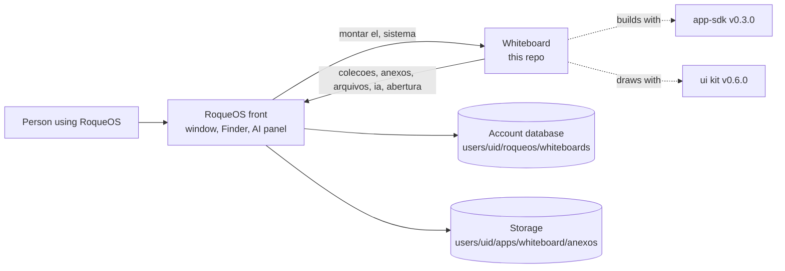
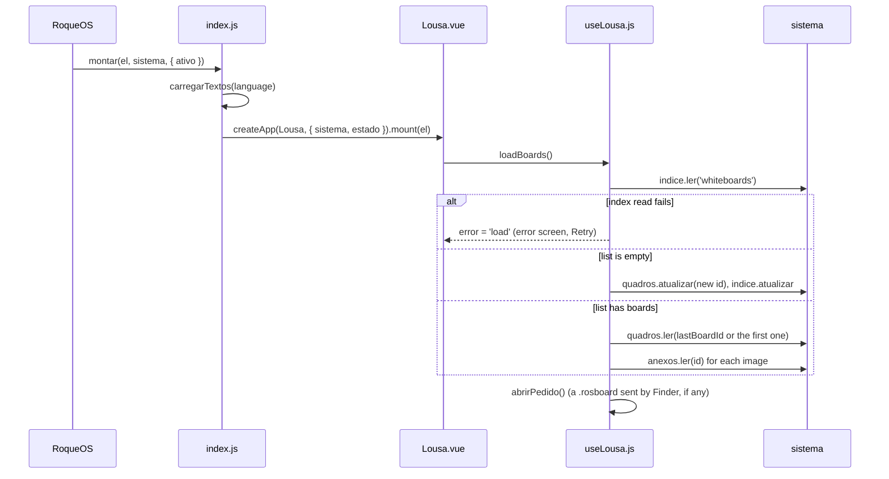
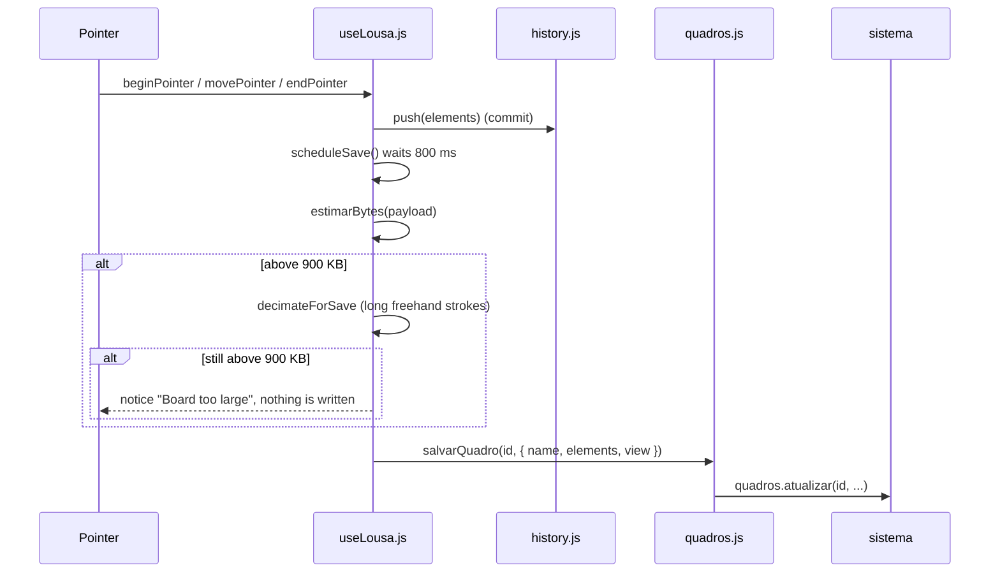
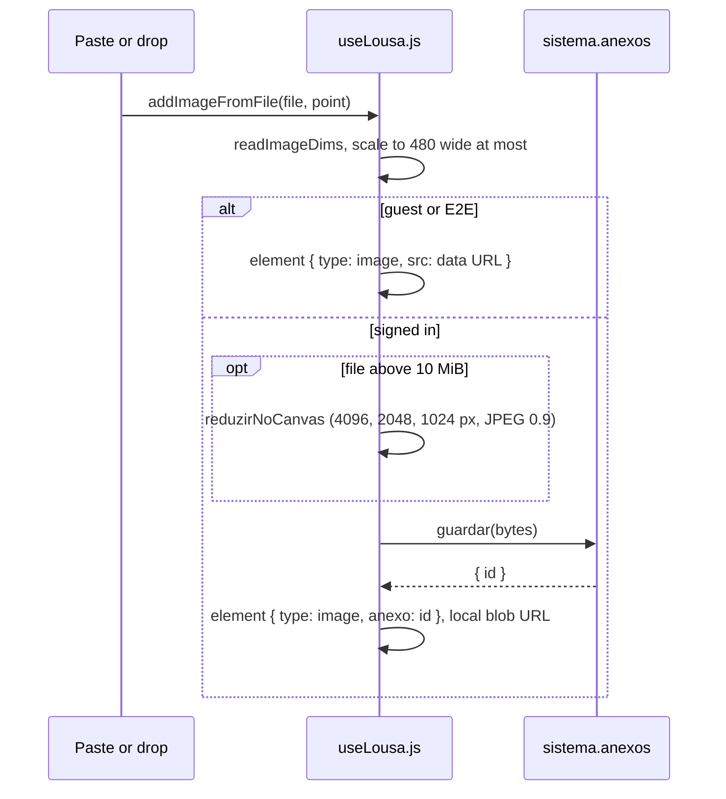
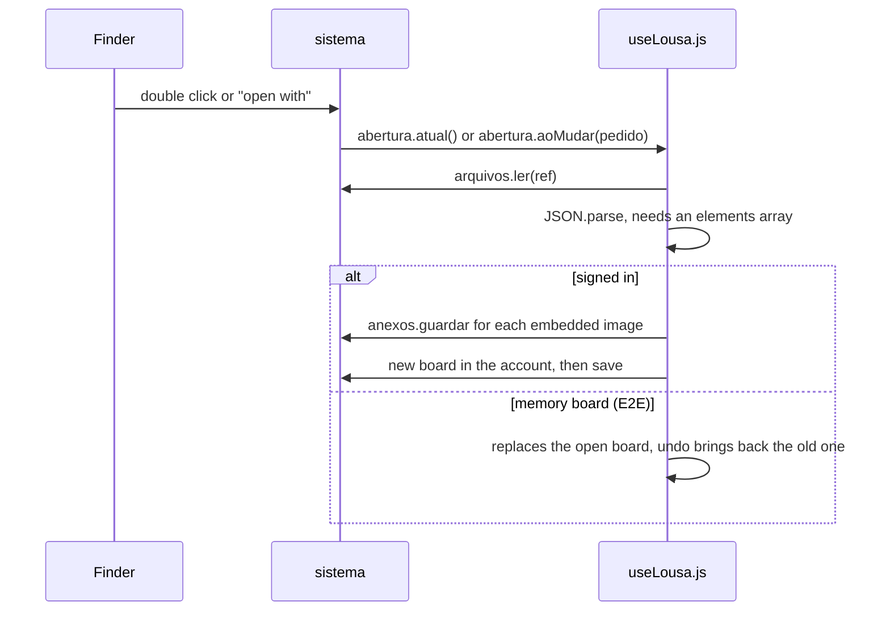

# Architecture

_[Português](pt-BR/ARQUITETURA.md) | English_

> **Who this is for:** an engineer who is about to change the Whiteboard and wants to know where each piece lives before touching it.
> **What is here:** the idea, the context around RoqueOS, the components with their files, the main flows as sequence diagrams, the stored formats, secrets, the design decisions and the known limits.
> **Where to go for the rest:** every command and constant in [REFERENCE.md](REFERENCE.md), how the app talks to the system in [INTEGRATIONS.md](INTEGRATIONS.md), why each permanent rule exists in [DECISIONS.md](DECISIONS.md).

## Contents

1. [The idea in one paragraph](#1-the-idea-in-one-paragraph)
2. [Context: who uses it and what it depends on](#2-context-who-uses-it-and-what-it-depends-on)
3. [Processes and where they run](#3-processes-and-where-they-run)
4. [Components](#4-components)
5. [The main flows](#5-the-main-flows)
6. [Data and contracts](#6-data-and-contracts)
7. [Security and secrets](#7-security-and-secrets)
8. [Design decisions](#8-design-decisions)
9. [Known limits](#9-known-limits)
10. [How the diagrams are made](#10-how-the-diagrams-are-made)

## 1. The idea in one paragraph

The Whiteboard (repository `lousa`, app id `whiteboard`) is an infinite SVG board that RoqueOS installs as a dependency by git tag. It is a Vue 3 app that mounts itself inside the element RoqueOS hands over and talks to the system only through the `sistema` object of [`@roqueos-apps/app-sdk`](https://github.com/roqueos-apps/app-sdk): boards are documents in two collections, pasted images are attachments, the AI panel belongs to the system. The same code runs inside RoqueOS, alone in the browser with `yarn dev`, and in the tests, because all three hand it a `sistema` with the same contract ([`src/index.js`](../src/index.js), [`dev/main.js`](../dev/main.js), [`test/app.spec.js`](../test/app.spec.js)).

## 2. Context: who uses it and what it depends on



| Dependency                                 | What for                                                              | What happens when it is missing                                                                                                            |
| ------------------------------------------ | --------------------------------------------------------------------- | ------------------------------------------------------------------------------------------------------------------------------------------ |
| RoqueOS (`sistema` of the app-sdk)         | account, collections, attachments, files, AI panel, language, notices | outside RoqueOS the app runs on the development system of the SDK (`yarn dev`) or the fake system (tests)                                  |
| Account collections `quadros` and `indice` | the boards and their list                                             | a read failure shows the error screen with Retry; nothing is written over the list ([`src/useLousa.js`](../src/useLousa.js), `loadBoards`) |
| `sistema.anexos`                           | pasted images, by id                                                  | the image element stays empty and the rest of the board opens ([`src/useLousa.js`](../src/useLousa.js), `resolverAnexos`)                  |
| `sistema.ia`                               | the read-only AI panel                                                | the button opens nothing; the board keeps working                                                                                          |
| `@roqueos-apps/app-sdk` `v0.3.0`           | `definirApp`, the contract, `app check`, the dev and fake systems     | pinned by tag in [`package.json`](../package.json)                                                                                         |
| `@roqueos-apps/ui` `v0.6.0`                | buttons, icons, sheet, empty state                                    | pinned by tag in [`package.json`](../package.json); arrives as `.vue` source                                                               |
| `vue` `^3.5.0`                             | the framework                                                         | peer dependency: RoqueOS provides it                                                                                                       |

The storage paths in the diagram are decided by RoqueOS, not by this repo. They are the same places the board used before it left the core on 28/09/2026, so nothing was migrated ([`src/quadros.js`](../src/quadros.js), header comment).

## 3. Processes and where they run

There is no server and no background job. Everything runs in the browser tab of whoever opens the window.

| Process                  | Where                            | How it starts                                                                                          | Who calls it                                                 |
| ------------------------ | -------------------------------- | ------------------------------------------------------------------------------------------------------ | ------------------------------------------------------------ |
| The app inside RoqueOS   | the RoqueOS tab, same origin     | RoqueOS imports `@roqueos-apps/lousa` and calls `montar(el, sistema, { ativo })`                       | the RoqueOS window manager                                   |
| `yarn dev`               | Vite on `http://localhost:5173/` | [`index.html`](../index.html) loads [`dev/main.js`](../dev/main.js), which calls `montarNaJanelaFalsa` | you                                                          |
| `yarn test`              | Vitest in Node with jsdom        | [`vite.config.js`](../vite.config.js), setup in [`test/preparar.js`](../test/preparar.js)              | you, CI and the pre-push gate                                |
| `app check`              | Node, the `app` bin of the SDK   | `yarn app:check`                                                                                       | `yarn verificar`                                             |
| CI `verificar` and `dco` | GitHub Actions, `ubuntu-latest`  | push to `main` and every pull request                                                                  | GitHub ([`.github/workflows/`](../.github/workflows/ci.yml)) |

Inside RoqueOS the app is compiled by the RoqueOS Vite, not by [`vite.config.js`](../vite.config.js): the package ships `src`, `i18n`, `app.json`, `paridade.json`, `ASSETS.md`, `LICENSE` and `README.md` ([`package.json`](../package.json), `files`).

## 4. Components

| File                                                               | Responsibility                                                                                                                                                                       | Depends on it                                           |
| ------------------------------------------------------------------ | ------------------------------------------------------------------------------------------------------------------------------------------------------------------------------------ | ------------------------------------------------------- |
| [`app.json`](../app.json)                                          | the manifest: permanent id `whiteboard`, name and description in ten languages, icon `draw`, color `#0ea5e9`, window size, capabilities, collections, the `.rosboard` type in `abre` | RoqueOS, `app check`, `test/app.spec.js`                |
| [`src/index.js`](../src/index.js)                                  | `definirApp`: loads the texts, creates a Vue app inside the element, `ativar` and `desmontar`; repeats the capabilities of `app.json` in `CAPACIDADES`                               | RoqueOS, `dev/main.js`                                  |
| [`src/Lousa.vue`](../src/Lousa.vue)                                | the screen: wide and narrow bars, the SVG stage, the text editor, pointer, touch, wheel, keyboard, paste and drop, the AI panel actions                                              | `index.js`                                              |
| [`src/Ferramentas.vue`](../src/Ferramentas.vue)                    | tools, colors, stroke width, options, export                                                                                                                                         | `Lousa.vue`                                             |
| [`src/Quadros.vue`](../src/Quadros.vue)                            | the board list: open, create, rename, delete                                                                                                                                         | `Lousa.vue`                                             |
| [`src/useLousa.js`](../src/useLousa.js)                            | the engine: state, pointer state machine, history, autosave, boards, images, export, `.rosboard`, guest drawing, account change                                                      | `Lousa.vue` and its children through `provide('lousa')` |
| [`src/quadros.js`](../src/quadros.js)                              | boards in the account through `sistema.colecoes`; `ID_DO_INDICE`, `LIMITE_DO_QUADRO`, `limparElementos`, `estimarBytes`                                                              | `useLousa.js`                                           |
| [`src/elements.js`](../src/elements.js)                            | element model and factories, freehand normalization, `migrateElement` for the old format, `boardToText` for the AI                                                                   | engine, geometry, serializer                            |
| [`src/geometry.js`](../src/geometry.js)                            | selection bounds, handles, rotation-aware hit test, move, resize, rotate, content bounds                                                                                             | engine                                                  |
| [`src/history.js`](../src/history.js)                              | undo and redo by whole snapshots, 60 at most                                                                                                                                         | engine                                                  |
| [`src/serialize.js`](../src/serialize.js)                          | the board as an SVG string, cut to the content bounds, with `escapeXml`                                                                                                              | export                                                  |
| [`src/export.js`](../src/export.js), [`src/pdf.js`](../src/pdf.js) | SVG to PNG and JPEG through a canvas; a one-page PDF writer with no dependency                                                                                                       | engine                                                  |
| [`src/textos.js`](../src/textos.js)                                | loads `i18n/<language>.json` as text (`?raw`) and translates a key                                                                                                                   | `index.js`, `Lousa.vue`                                 |
| [`i18n/`](../i18n/pt-BR.json)                                      | 64 interface keys in each of the ten languages                                                                                                                                       | `textos.js`, `app check`                                |
| [`paridade.json`](../paridade.json)                                | inventory of what the app did inside RoqueOS and what happened to each item                                                                                                          | RoqueOS, before accepting a version                     |
| `src/*.scss`                                                       | the look, with `--lousa-*` variables over the SDK theme variables                                                                                                                    | the components                                          |

## 5. The main flows

### 5.1 Opening the window



The app only mounts once the texts are loaded, so the buttons never show without a label ([`src/index.js`](../src/index.js)). The last opened board comes back; if it is no longer in the list, the first one opens; a new board is created only when the list is empty ([`src/useLousa.js`](../src/useLousa.js), `abrirOsQuadros`).

### 5.2 Drawing and autosave



Each change restarts an 800 ms timer and then writes the whole open board: name, elements and view. Guests and the E2E session never write ([`src/useLousa.js`](../src/useLousa.js), `soNaMemoria`). Decimation keeps one point out of every two in freehand strokes whose `points` array has more than 80 values; the test that holds this is `quadro grande dizima só o traço longo, e avisa que simplificou` in [`test/lousa.spec.js`](../test/lousa.spec.js).

### 5.3 Pasting an image



The attachment id is the only thing the board stores. The storage address never reaches the app, and the image does not count against the board document size ([`src/useLousa.js`](../src/useLousa.js), `addImageFromFile`).

### 5.4 Opening a `.rosboard` from Finder



Without an account the system does not read files, and the app shows a notice and keeps the drawing ([`test/lousa.spec.js`](../test/lousa.spec.js), `sem conta, o sistema não lê o arquivo`).

## 6. Data and contracts

A board document in the `quadros` collection, id `wb_<genId>`:

```json
{
  "name": "Sprint",
  "elements": [
    {
      "id": "el_m1abc_1_k2",
      "type": "rectangle",
      "x": 10,
      "y": 20,
      "w": 200,
      "h": 120,
      "angle": 0,
      "stroke": "#1e1e1e",
      "strokeWidth": 2,
      "fill": null,
      "z": 0
    },
    {
      "id": "el_m1abc_2_k3",
      "type": "image",
      "x": 0,
      "y": 0,
      "w": 480,
      "h": 270,
      "angle": 0,
      "stroke": "#1e1e1e",
      "strokeWidth": 2,
      "fill": null,
      "z": 0,
      "src": "",
      "anexo": "<attachment id>"
    }
  ],
  "view": { "zoom": 1, "panX": 0, "panY": 0 }
}
```

The index is the `whiteboards` document of the `indice` collection: `{ "lastBoardId": "wb_...", "boards": [{ "id": "wb_...", "name": "Sprint" }] }`. The system stamps `atualizadoEm` on both. A `.rosboard` file is `{ "version": 2, "name": ..., "elements": [...] }` with the images embedded as data URLs, saved with type `application/vnd.roqueos.rosboard+json` in Documents. Every field, element by element, is in [REFERENCE.md](REFERENCE.md#formats).

Geometry is stored normalized: every element is a box `x, y, w, h` plus `angle` in degrees around its center, and freehand and segment points are fractions of that box in a flat array. Moving is translating `x, y`; resizing changes `w, h` and the points follow for free ([`src/elements.js`](../src/elements.js), header comment).

## 7. Security and secrets

The repo has no secret, no token and no `.env`. CI reads no secret and runs with `contents: read` ([`.github/workflows/ci.yml`](../.github/workflows/ci.yml)). The app never sees a database credential, a storage URL of an attachment, an AI agent or an AI key: those stay on the system side. Board text reaches the screen only as text (Vue interpolation, `escapeXml` in the exported SVG). The full picture is in [THREAT-MODEL.md](THREAT-MODEL.md) and the reporting channel in [`SECURITY.md`](../SECURITY.md).

## 8. Design decisions

Each one has its date, the alternative that was refused and the reason in [DECISIONS.md](DECISIONS.md).

| Decided                                                                               | Refused                                                  | Why                                                                                     |
| ------------------------------------------------------------------------------------- | -------------------------------------------------------- | --------------------------------------------------------------------------------------- |
| Permanent id `whiteboard`, collections `quadros` and `indice`, index id `whiteboards` | renaming to match the repo                               | RoqueOS finds windows, shortcuts and existing boards by them                            |
| Stored board format is additive only                                                  | renaming or changing the meaning of a field              | the boards people already have would lose data; old formats go through `migrateElement` |
| One board read at a time with `ler(id)`                                               | observing the whole collection                           | a board gets close to the 1 MB per document limit                                       |
| Images as attachments by id                                                           | embedding in the board, or a file in the user's Pictures | 1 MB per document; the address must not live in the board                               |
| A read error becomes the error screen                                                 | treating it as "no boards"                               | that path once created a new board and wrote the index over the user's list             |
| Texts loaded with `?raw` and `JSON.parse`                                             | importing JSON directly                                  | the RoqueOS build breaks on direct JSON import outside its own `src/i18n/`              |
| Save after 800 ms, no realtime                                                        | live collaboration                                       | collaboration is another version ([`src/useLousa.js`](../src/useLousa.js), header)      |
| PDF written by hand, one JPEG in one page                                             | a PDF library                                            | the project ships no PDF dependency ([`src/pdf.js`](../src/pdf.js))                     |

## 9. Known limits

- Not proven in production. The audit of 28/09/2026 in [`paridade.json`](../paridade.json) says nothing was measured with a real session or on a real iPhone at that time; this repo holds no newer measurement.
- A board above 900 KB after decimation is not saved at all; the person gets a notice and only an export or deleting elements helps.
- Decimation loses detail for good: the saved stroke has half the points.
- Images in memory on `yarn dev` disappear on F5; boards in `localStorage` stay.
- The PDF is a raster image (JPEG at 2x), not vector, and has a single page sized to the content.
- The error screen after a failed load uses the title of `saveError` ("Error saving board") with the message `erroGenerico`, even though it was a read that failed ([`src/Lousa.vue`](../src/Lousa.vue)).
- `diamond` has no keyboard shortcut; every other drawing tool has one ([`src/Lousa.vue`](../src/Lousa.vue), `onKeyDown`).
- No undo across boards: history resets when another board opens.
- Older images saved with a public address (`src`) keep opening by that address; exporting them depends on the browser fetching it without credentials.

## 10. How the diagrams are made

All diagrams here are Mermaid inside this Markdown file, rendered by GitHub. The source is the text you are reading; the Portuguese pair translates the labels. There are no image diagrams to regenerate. The list of diagrams and where each one is explained is in [INDEX.md](INDEX.md#diagrams).
