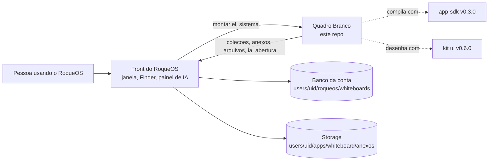
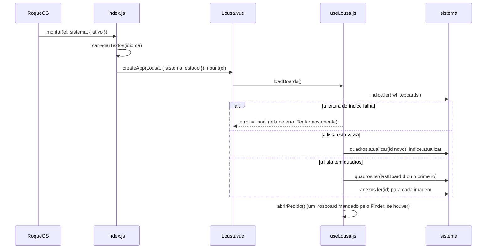
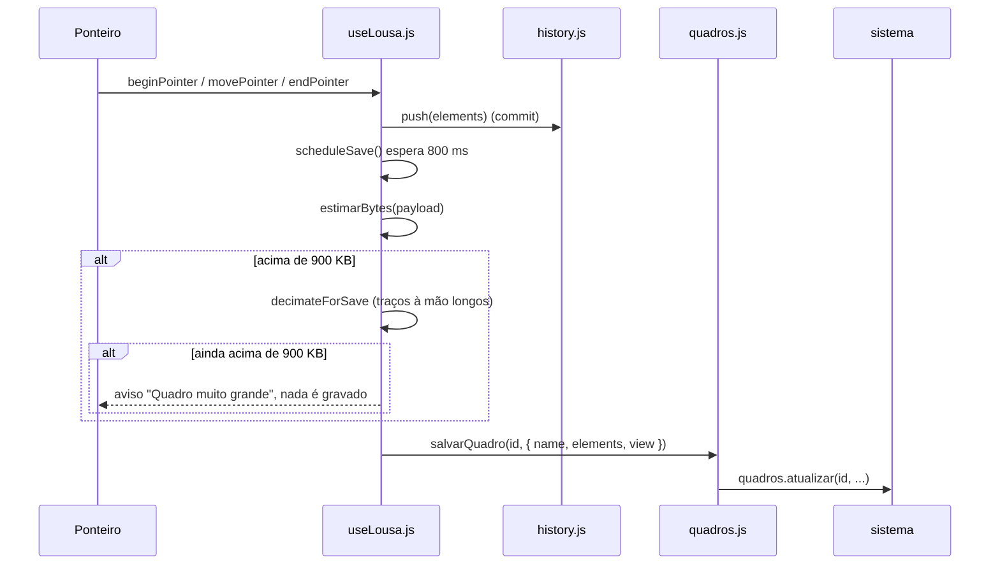
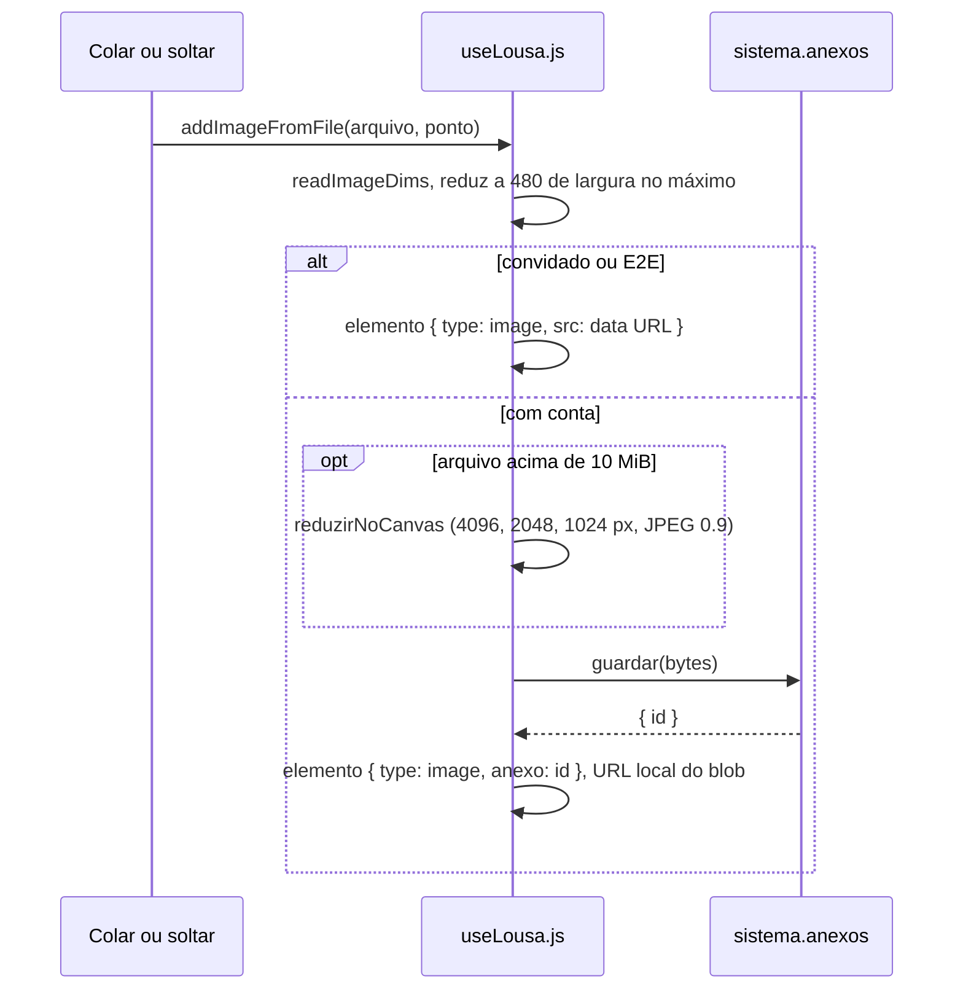
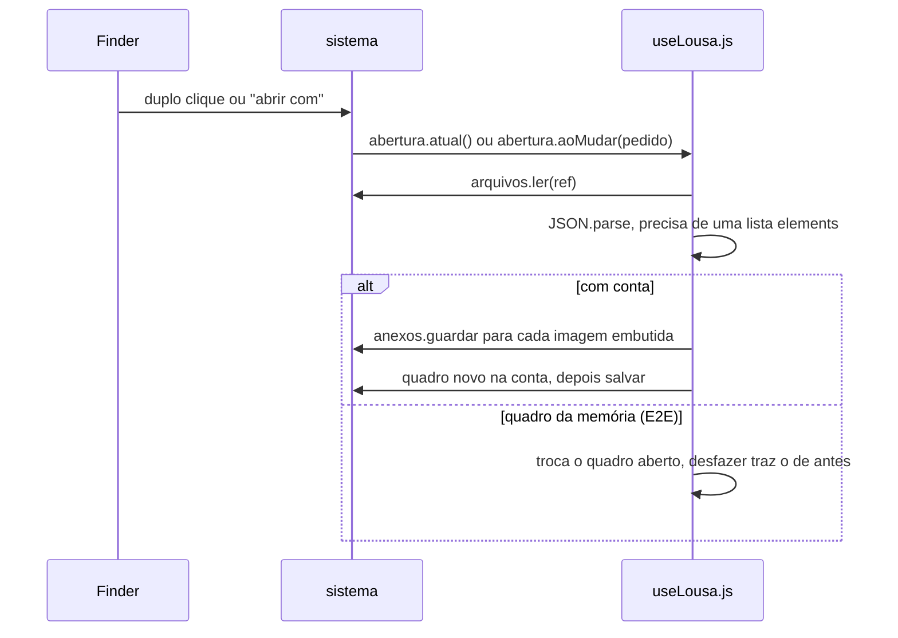

# Arquitetura

_Português | [English](../ARCHITECTURE.md)_

> **Para quem:** o engenheiro que vai mexer no Quadro Branco e quer saber onde mora cada peça antes de tocar nela.
> **O que tem aqui:** a ideia, o contexto em volta do RoqueOS, os componentes com os arquivos, os fluxos principais em diagrama de sequência, os formatos gravados, segredos, as decisões de design e os limites conhecidos.
> **Onde ir para o resto:** cada comando e constante em [REFERENCIA.md](REFERENCIA.md), como o app fala com o sistema em [INTEGRACOES.md](INTEGRACOES.md), por que cada regra permanente existe em [DECISOES.md](DECISOES.md).

## Sumário

1. [A ideia em um parágrafo](#1-a-ideia-em-um-parágrafo)
2. [Contexto: quem usa e do que depende](#2-contexto-quem-usa-e-do-que-depende)
3. [Processos e onde rodam](#3-processos-e-onde-rodam)
4. [Componentes](#4-componentes)
5. [Os fluxos principais](#5-os-fluxos-principais)
6. [Dados e contratos](#6-dados-e-contratos)
7. [Segurança e segredos](#7-segurança-e-segredos)
8. [Decisões de design](#8-decisões-de-design)
9. [Limites conhecidos](#9-limites-conhecidos)
10. [Como os diagramas são feitos](#10-como-os-diagramas-são-feitos)

## 1. A ideia em um parágrafo

O Quadro Branco (repositório `lousa`, id do app `whiteboard`) é um quadro infinito em SVG que o RoqueOS instala como dependência por tag de git. É um app Vue 3 que se monta dentro do elemento que o RoqueOS entrega e fala com o sistema só pelo objeto `sistema` do [`@roqueos-apps/app-sdk`](https://github.com/roqueos-apps/app-sdk): os quadros são documentos em duas coleções, as imagens coladas são anexos, o painel de IA é do sistema. O mesmo código roda dentro do RoqueOS, sozinho no navegador com `yarn dev` e nos testes, porque os três entregam um `sistema` com o mesmo contrato ([`src/index.js`](../../src/index.js), [`dev/main.js`](../../dev/main.js), [`test/app.spec.js`](../../test/app.spec.js)).

## 2. Contexto: quem usa e do que depende



| Dependência                            | Para quê                                                                      | O que acontece quando falta                                                                                                                          |
| -------------------------------------- | ----------------------------------------------------------------------------- | ---------------------------------------------------------------------------------------------------------------------------------------------------- |
| RoqueOS (o `sistema` do app-sdk)       | conta, coleções, anexos, arquivos, painel de IA, idioma, avisos               | fora do RoqueOS o app roda no sistema de desenvolvimento do SDK (`yarn dev`) ou no sistema falso (testes)                                            |
| Coleções `quadros` e `indice` da conta | os quadros e a lista deles                                                    | falha de leitura mostra a tela de erro com Tentar novamente; nada grava por cima da lista ([`src/useLousa.js`](../../src/useLousa.js), `loadBoards`) |
| `sistema.anexos`                       | imagens coladas, por id                                                       | o elemento de imagem fica vazio e o resto do quadro abre ([`src/useLousa.js`](../../src/useLousa.js), `resolverAnexos`)                              |
| `sistema.ia`                           | o painel de IA só de leitura                                                  | o botão não abre nada; o quadro continua funcionando                                                                                                 |
| `@roqueos-apps/app-sdk` `v0.3.0`       | `definirApp`, o contrato, `app check`, os sistemas de desenvolvimento e falso | pinado por tag no [`package.json`](../../package.json)                                                                                               |
| `@roqueos-apps/ui` `v0.6.0`            | botões, ícones, folha, estado vazio                                           | pinado por tag no [`package.json`](../../package.json); chega como fonte `.vue`                                                                      |
| `vue` `^3.5.0`                         | o framework                                                                   | dependência par: quem fornece é o RoqueOS                                                                                                            |

Os caminhos de armazenamento do diagrama são decididos pelo RoqueOS, não por este repo. São os mesmos lugares em que o quadro morava antes de sair do núcleo em 28/09/2026, então nada migrou ([`src/quadros.js`](../../src/quadros.js), comentário do topo).

## 3. Processos e onde rodam

Não há servidor nem job em segundo plano. Tudo roda na aba do navegador de quem abre a janela.

| Processo                | Onde                             | Como sobe                                                                                                        | Quem chama                                                        |
| ----------------------- | -------------------------------- | ---------------------------------------------------------------------------------------------------------------- | ----------------------------------------------------------------- |
| O app dentro do RoqueOS | a aba do RoqueOS, mesma origem   | o RoqueOS importa `@roqueos-apps/lousa` e chama `montar(el, sistema, { ativo })`                                 | o gerenciador de janelas do RoqueOS                               |
| `yarn dev`              | Vite em `http://localhost:5173/` | o [`index.html`](../../index.html) carrega o [`dev/main.js`](../../dev/main.js), que chama `montarNaJanelaFalsa` | você                                                              |
| `yarn test`             | Vitest no Node com jsdom         | [`vite.config.js`](../../vite.config.js), preparo em [`test/preparar.js`](../../test/preparar.js)                | você, o CI e o gate do pre-push                                   |
| `app check`             | Node, o bin `app` do SDK         | `yarn app:check`                                                                                                 | `yarn verificar`                                                  |
| CI `verificar` e `dco`  | GitHub Actions, `ubuntu-latest`  | push na `main` e todo pull request                                                                               | o GitHub ([`.github/workflows/`](../../.github/workflows/ci.yml)) |

Dentro do RoqueOS quem compila o app é o Vite do RoqueOS, não o [`vite.config.js`](../../vite.config.js): o pacote leva `src`, `i18n`, `app.json`, `paridade.json`, `ASSETS.md`, `LICENSE` e `README.md` ([`package.json`](../../package.json), `files`).

## 4. Componentes

| Arquivo                                                                  | Responsabilidade                                                                                                                                                                 | Quem depende dele                                  |
| ------------------------------------------------------------------------ | -------------------------------------------------------------------------------------------------------------------------------------------------------------------------------- | -------------------------------------------------- |
| [`app.json`](../../app.json)                                             | o manifesto: id permanente `whiteboard`, nome e descrição em dez idiomas, ícone `draw`, cor `#0ea5e9`, tamanho da janela, capacidades, coleções, o tipo do `.rosboard` em `abre` | o RoqueOS, o `app check`, o `test/app.spec.js`     |
| [`src/index.js`](../../src/index.js)                                     | `definirApp`: carrega os textos, cria um app Vue dentro do elemento, `ativar` e `desmontar`; repete as capacidades do `app.json` em `CAPACIDADES`                                | o RoqueOS, o `dev/main.js`                         |
| [`src/Lousa.vue`](../../src/Lousa.vue)                                   | a tela: barras larga e estreita, o palco em SVG, o editor de texto, ponteiro, toque, roda, teclado, colar e soltar, as ações do painel de IA                                     | o `index.js`                                       |
| [`src/Ferramentas.vue`](../../src/Ferramentas.vue)                       | ferramentas, cores, espessura, opções, exportação                                                                                                                                | o `Lousa.vue`                                      |
| [`src/Quadros.vue`](../../src/Quadros.vue)                               | a lista de quadros: abrir, criar, renomear, apagar                                                                                                                               | o `Lousa.vue`                                      |
| [`src/useLousa.js`](../../src/useLousa.js)                               | o motor: estado, máquina de ponteiro, histórico, salvamento automático, quadros, imagens, exportação, `.rosboard`, desenho do convidado, troca de conta                          | o `Lousa.vue` e os filhos, pelo `provide('lousa')` |
| [`src/quadros.js`](../../src/quadros.js)                                 | os quadros na conta pelo `sistema.colecoes`; `ID_DO_INDICE`, `LIMITE_DO_QUADRO`, `limparElementos`, `estimarBytes`                                                               | o `useLousa.js`                                    |
| [`src/elements.js`](../../src/elements.js)                               | modelo e fábricas de elemento, normalização do traço à mão, `migrateElement` para o formato antigo, `boardToText` para a IA                                                      | motor, geometria, serializador                     |
| [`src/geometry.js`](../../src/geometry.js)                               | caixa da seleção, alças, teste de acerto que considera a rotação, mover, redimensionar, girar, caixa do conteúdo                                                                 | o motor                                            |
| [`src/history.js`](../../src/history.js)                                 | desfazer e refazer por fotos inteiras, 60 no máximo                                                                                                                              | o motor                                            |
| [`src/serialize.js`](../../src/serialize.js)                             | o quadro como texto SVG, recortado na caixa do conteúdo, com `escapeXml`                                                                                                         | a exportação                                       |
| [`src/export.js`](../../src/export.js), [`src/pdf.js`](../../src/pdf.js) | SVG para PNG e JPEG por um canvas; um gerador de PDF de uma página sem dependência                                                                                               | o motor                                            |
| [`src/textos.js`](../../src/textos.js)                                   | carrega `i18n/<idioma>.json` como texto (`?raw`) e traduz uma chave                                                                                                              | o `index.js`, o `Lousa.vue`                        |
| [`i18n/`](../../i18n/pt-BR.json)                                         | 64 chaves de interface em cada um dos dez idiomas                                                                                                                                | o `textos.js`, o `app check`                       |
| [`paridade.json`](../../paridade.json)                                   | inventário do que o app fazia dentro do RoqueOS e do que aconteceu com cada item                                                                                                 | o RoqueOS, antes de aceitar uma versão             |
| `src/*.scss`                                                             | o visual, com variáveis `--lousa-*` sobre as variáveis de tema do SDK                                                                                                            | os componentes                                     |

## 5. Os fluxos principais

### 5.1 Abrir a janela



O app só monta com os textos carregados, então os botões nunca aparecem sem rótulo ([`src/index.js`](../../src/index.js)). O último quadro aberto volta; se ele não está mais na lista, abre o primeiro; quadro novo só nasce quando a lista está vazia ([`src/useLousa.js`](../../src/useLousa.js), `abrirOsQuadros`).

### 5.2 Desenhar e salvar sozinho



Cada mudança reinicia um timer de 800 ms e depois grava o quadro aberto inteiro: nome, elementos e vista. Convidado e sessão de E2E nunca gravam ([`src/useLousa.js`](../../src/useLousa.js), `soNaMemoria`). A dizimação guarda um ponto de cada dois nos traços à mão cujo `points` tem mais de 80 valores; o teste que segura isso é o `quadro grande dizima só o traço longo, e avisa que simplificou` no [`test/lousa.spec.js`](../../test/lousa.spec.js).

### 5.3 Colar uma imagem



O id do anexo é a única coisa que o quadro guarda. O endereço no Storage nunca chega ao app, e a imagem não conta contra o tamanho do documento do quadro ([`src/useLousa.js`](../../src/useLousa.js), `addImageFromFile`).

### 5.4 Abrir um `.rosboard` pelo Finder



Sem conta o sistema não lê arquivo, e o app avisa e mantém o desenho ([`test/lousa.spec.js`](../../test/lousa.spec.js), `sem conta, o sistema não lê o arquivo`).

## 6. Dados e contratos

Um documento de quadro na coleção `quadros`, id `wb_<genId>`:

```json
{
  "name": "Sprint",
  "elements": [
    {
      "id": "el_m1abc_1_k2",
      "type": "rectangle",
      "x": 10,
      "y": 20,
      "w": 200,
      "h": 120,
      "angle": 0,
      "stroke": "#1e1e1e",
      "strokeWidth": 2,
      "fill": null,
      "z": 0
    },
    {
      "id": "el_m1abc_2_k3",
      "type": "image",
      "x": 0,
      "y": 0,
      "w": 480,
      "h": 270,
      "angle": 0,
      "stroke": "#1e1e1e",
      "strokeWidth": 2,
      "fill": null,
      "z": 0,
      "src": "",
      "anexo": "<id do anexo>"
    }
  ],
  "view": { "zoom": 1, "panX": 0, "panY": 0 }
}
```

O índice é o documento `whiteboards` da coleção `indice`: `{ "lastBoardId": "wb_...", "boards": [{ "id": "wb_...", "name": "Sprint" }] }`. O sistema carimba `atualizadoEm` nos dois. Um arquivo `.rosboard` é `{ "version": 2, "name": ..., "elements": [...] }` com as imagens embutidas como data URL, gravado com o tipo `application/vnd.roqueos.rosboard+json` em Documentos. Cada campo, elemento por elemento, está em [REFERENCIA.md](REFERENCIA.md#formatos).

A geometria é gravada normalizada: todo elemento é uma caixa `x, y, w, h` mais `angle` em graus em torno do centro, e os pontos do traço à mão e do segmento são frações dessa caixa numa lista plana. Mover é transladar `x, y`; redimensionar muda `w, h` e os pontos acompanham de graça ([`src/elements.js`](../../src/elements.js), comentário do topo).

## 7. Segurança e segredos

O repo não tem segredo, token nem `.env`. O CI não lê segredo nenhum e roda com `contents: read` ([`.github/workflows/ci.yml`](../../.github/workflows/ci.yml)). O app nunca vê credencial de banco, endereço de Storage de um anexo, agente de IA ou chave de IA: isso fica do lado do sistema. O texto do quadro só chega à tela como texto (interpolação do Vue, `escapeXml` no SVG exportado). O quadro completo está em [MODELO-DE-AMEACAS.md](MODELO-DE-AMEACAS.md) e o canal de relato no [`SECURITY.md`](../../SECURITY.md).

## 8. Decisões de design

Cada uma tem a data, a alternativa recusada e o motivo em [DECISOES.md](DECISOES.md).

| Decidido                                                                              | Recusado                                            | Por quê                                                                                    |
| ------------------------------------------------------------------------------------- | --------------------------------------------------- | ------------------------------------------------------------------------------------------ |
| Id permanente `whiteboard`, coleções `quadros` e `indice`, id do índice `whiteboards` | renomear para casar com o repo                      | é por eles que o RoqueOS acha janelas, atalhos e os quadros de quem já usa                 |
| O formato gravado do quadro só cresce                                                 | renomear ou mudar o sentido de um campo             | os quadros que as pessoas já têm perderiam dado; formato velho passa pelo `migrateElement` |
| Um quadro lido por vez com `ler(id)`                                                  | observar a coleção inteira                          | um quadro chega perto do limite de 1 MB por documento                                      |
| Imagem como anexo por id                                                              | embutir no quadro, ou arquivo nas Imagens da pessoa | 1 MB por documento; o endereço não pode morar no quadro                                    |
| Erro de leitura vira a tela de erro                                                   | tratar como "nenhum quadro"                         | esse caminho já criou um quadro novo e gravou o índice por cima da lista da pessoa         |
| Textos carregados com `?raw` e `JSON.parse`                                           | importar JSON direto                                | o build do RoqueOS quebra com import de JSON fora do `src/i18n/` dele                      |
| Gravar depois de 800 ms, sem tempo real                                               | colaboração ao vivo                                 | colaboração é outra versão ([`src/useLousa.js`](../../src/useLousa.js), topo)              |
| PDF escrito à mão, um JPEG numa página                                                | uma biblioteca de PDF                               | o projeto não leva dependência de PDF ([`src/pdf.js`](../../src/pdf.js))                   |

## 9. Limites conhecidos

- Não provado em produção. A auditoria de 28/09/2026 no [`paridade.json`](../../paridade.json) diz que nada foi medido com sessão real nem num iPhone de verdade naquela data; este repo não guarda medição mais nova.
- Quadro acima de 900 KB depois da dizimação não é gravado; a pessoa recebe o aviso e só exportar ou apagar elementos resolve.
- A dizimação perde detalhe para sempre: o traço gravado fica com metade dos pontos.
- Imagens em memória no `yarn dev` somem no F5; quadros no `localStorage` ficam.
- O PDF é uma imagem raster (JPEG em 2x), não vetor, e tem uma página só, do tamanho do conteúdo.
- A tela de erro depois de uma abertura que falhou usa o título de `saveError` ("Erro ao salvar quadro") com a mensagem `erroGenerico`, embora quem falhou tenha sido uma leitura ([`src/Lousa.vue`](../../src/Lousa.vue)).
- `diamond` não tem atalho de teclado; toda outra ferramenta de desenho tem ([`src/Lousa.vue`](../../src/Lousa.vue), `onKeyDown`).
- Não há desfazer entre quadros: o histórico zera quando outro quadro abre.
- Imagem antiga gravada com endereço público (`src`) continua abrindo por esse endereço; exportá-la depende de o navegador buscá-la sem credencial.

## 10. Como os diagramas são feitos

Todos os diagramas daqui são Mermaid dentro deste Markdown, renderizados pelo GitHub. A fonte é o texto que você está lendo; o par em inglês tem os rótulos em inglês. Não há diagrama em imagem para regenerar. A lista dos diagramas e onde cada um é explicado está em [INDEX.md](INDEX.md#diagramas).
